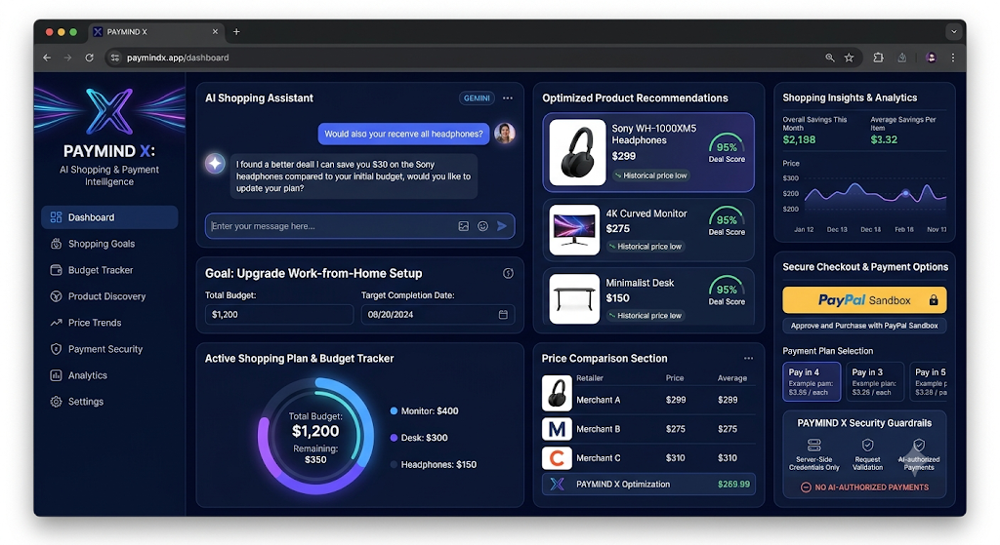
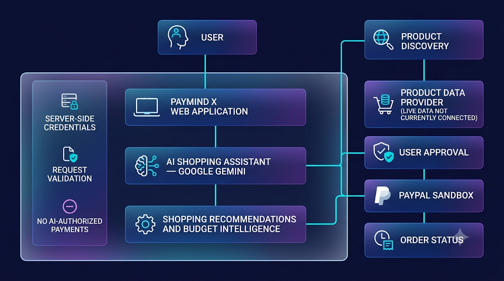
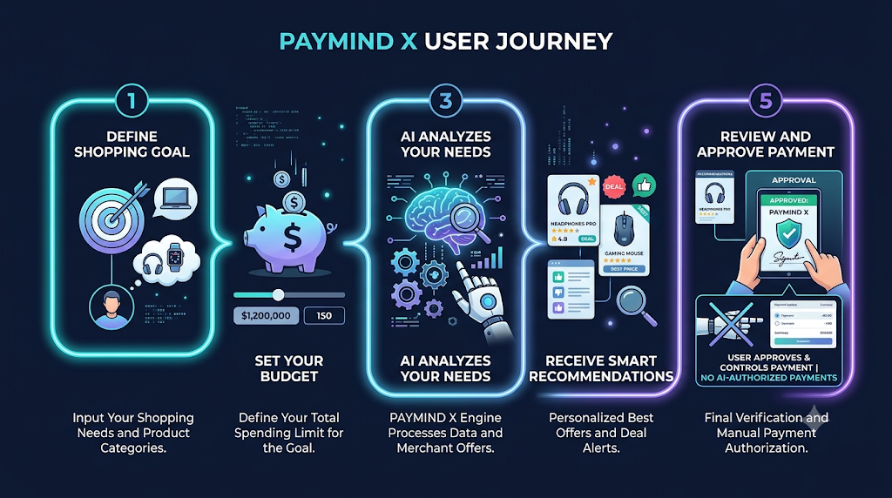
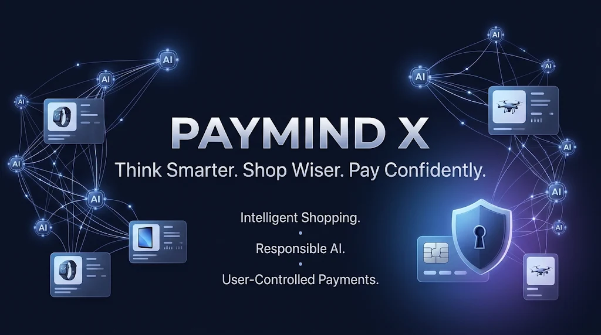

# PAYMIND X
### Think Smarter. Shop Wiser. Pay Confidently.

**AI-Powered Shopping & Payment Intelligence**

🌐 **[OPEN LIVE DASHBOARD](https://paymind-x.vercel.app)**

💻 **[GitHub Repository](https://github.com/snehassneha4578-collab/PAYMIND-X)**

<p align="center">
  
</p>

---

## 🚀 1. Project Overview

PAYMIND X is an AI-powered shopping and payment intelligence platform designed to help users make smarter, more informed purchasing decisions.

The platform combines AI-powered shopping assistance, budget-conscious recommendations, an interactive shopping dashboard, and a PayPal Sandbox payment workflow.

Users can describe their shopping requirements, specify their budget, receive AI-generated guidance, and explore a simulated payment process while retaining complete control over payment approval.

**Our vision:** Make online shopping more intelligent, transparent, and user-controlled.

## 🎯 2. Problem Statement

Online shoppers frequently face challenges such as:

- Finding suitable products within a specific budget.
- Comparing options and understanding product trade-offs.
- Making informed purchasing decisions.
- Understanding payment workflows and security.
- Getting personalized shopping guidance.

PAYMIND X addresses these challenges through an integrated AI-powered shopping intelligence experience.

## 💡 3. Key Features

| Feature | Description |
|---|---|
| AI Shopping Assistant | Generates shopping guidance using Google Gemini. |
| Budget Intelligence | Helps users evaluate choices according to their budget. |
| Smart Recommendations | Provides AI-generated suggestions based on user requirements. |
| Interactive Dashboard | Centralized shopping intelligence interface. |
| PayPal Sandbox | Demonstrates a simulated payment workflow. |
| Secure Payment Validation | Validates order details on the server. |
| Responsible AI | Keeps payment authorization under user control. |

## 🖥️ 4. Application Dashboard

The PAYMIND X dashboard provides a centralized interface for shopping intelligence and AI-assisted purchasing decisions.

<p align="center">
  
</p>

**Dashboard highlights:**
- Shopping intelligence overview.
- Illustrative product cards.
- Budget-oriented shopping experience.
- AI shopping assistant.
- Payment workflow access.

*Note: Displayed product examples and prices are illustrative, not verified live marketplace listings.*

## 🏗️ 5. System Architecture

PAYMIND X integrates its web application, AI recommendation service, and PayPal Sandbox payment workflow.

<p align="center">
  
</p>

**Architecture components:**

1. **Frontend:** Next.js web application.
2. **AI Intelligence:** Google Gemini API for shopping recommendations.
3. **Payment Integration:** PayPal Sandbox REST API.
4. **Validation Layer:** Server-side request and payment validation.
5. **Deployment:** Vercel hosting.

**Product-data transparency:** A live marketplace product-data provider is not currently connected. The application does not represent illustrative products as live listings.

## 🤖 6. AI Shopping Workflow

The AI shopping assistant follows a user-driven recommendation process.

<p align="center">
  
</p>

**Workflow:**

1. Define your shopping goal.
2. Enter your budget.
3. Submit your shopping requirements.
4. Receive AI-generated recommendations.
5. Review the guidance and make your own purchasing decision.

AI recommendations are advisory. The user makes the final decision.

## 💳 7. PayPal Sandbox Integration

PAYMIND X demonstrates payment processing through the PayPal Sandbox environment.

**Payment workflow:**

1. The application creates a validated Sandbox order.
2. The user receives a PayPal Sandbox approval link.
3. The server verifies the order details.
4. Capture is attempted only after PayPal confirms approval.
5. The application verifies the final payment status.

**Important:** This is a simulated payment demonstration using a fixed USD 1.00 Sandbox order. It does not represent a real purchase, merchant order, or product delivery.

AI cannot independently authorize or capture payments.

## 🔐 8. Security & Responsible AI

<p align="center">
  
</p>

Security considerations include:

- Server-side storage of payment credentials.
- Environment secrets excluded from Git.
- Server-side validation of payment requests.
- Verification of order details before capture.
- Payment status verification through PayPal.
- No AI-controlled payment authorization.
- User-controlled payment approval.

PAYMIND X is designed around transparency, responsible AI, and secure payment handling.

## 🛠️ 9. Technology Stack

| Category | Technologies |
|---|---|
| Frontend | Next.js, React, TypeScript |
| Styling | Tailwind CSS |
| AI Integration | Google Gemini API |
| Payment Integration | PayPal Sandbox REST API |
| Validation | Zod |
| Deployment | Vercel |
| Version Control | Git, GitHub |

## ⚙️ 10. Installation & Setup

### Prerequisites

- Node.js
- npm
- Git
- Google Gemini API key
- PayPal Sandbox application credentials

### Step 1: Clone the repository

```bash
git clone https://github.com/snehassneha4578-collab/PAYMIND-X.git
cd PAYMIND-X
```

### Step 2: Install dependencies

```bash
npm install
```

### Step 3: Configure environment variables

Create a `.env.local` file in the project root:

```env
GEMINI_API_KEY=your_gemini_api_key
PAYPAL_CLIENT_ID=your_paypal_sandbox_client_id
PAYPAL_CLIENT_SECRET=your_paypal_sandbox_client_secret
PAYPAL_BASE_URL=https://api-m.sandbox.paypal.com
NEXT_PUBLIC_APP_NAME=PAYMIND X
```

Never commit `.env.local` or expose API credentials.

### Step 4: Start the development server

```bash
npm run dev
```

Open your browser:

```text
http://localhost:3000
```

### Step 5: Build for production

```bash
npm run build
```

## ⚠️ 11. Current Limitations

- Live marketplace product listings are not currently connected.
- Product examples and displayed prices are illustrative.
- AI recommendation availability depends on the external Gemini service.
- PayPal integration uses Sandbox rather than live payment processing.
- Sandbox transactions do not represent real purchases or deliveries.

## 🔮 12. Future Enhancements

- Integration with an approved live product-data provider.
- More advanced product comparison capabilities.
- Improved personalized shopping recommendations.
- Enhanced budget and shopping analytics.
- AI reliability monitoring and improvements.
- Expanded payment workflow testing.

## 🌟 13. Project Impact

PAYMIND X demonstrates how AI and payment technology can work together to improve the online shopping decision-making experience.

It brings together:

- Intelligent shopping assistance.
- Budget-conscious recommendations.
- Responsible AI integration.
- PayPal Sandbox payment demonstration.
- User-controlled payment approval.

## 📜 14. License

Refer to the repository's `LICENSE` file for the applicable license terms.

---

<p align="center">
  
</p>

<h2 align="center">PAYMIND X</h2>

<p align="center">
  <strong>Intelligent Shopping. Responsible AI. User-Controlled Payments.</strong>
</p>

<p align="center">
  🌐 <a href="https://paymind-x.vercel.app">LIVE DASHBOARD</a>
  &nbsp; | &nbsp;
  💻 <a href="https://github.com/snehassneha4578-collab/PAYMIND-X">GITHUB REPOSITORY</a>
</p>
